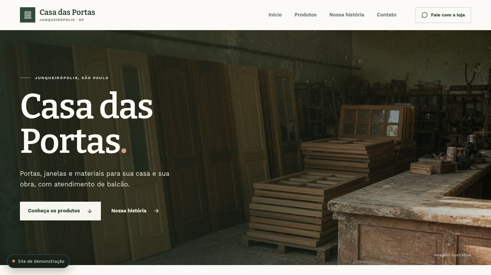

# Casa das Portas

Vitrine digital de uma loja de portas, janelas, esquadrias e madeira em Junqueirópolis (SP). O site apresenta o catálogo, permite montar uma lista de orçamento e simula o envio do pedido pelo WhatsApp.

> **Demonstração pública.** Telefone, WhatsApp, e-mail, endereço, redes sociais, fotos de produto e preços são fictícios. Nenhum contato ou pedido é enviado de verdade.

**Demo:** [casa-das-portas.vercel.app](https://casa-das-portas.vercel.app)  
**Stack:** React 19 · TypeScript · Vite 7 · Tailwind CSS 4 · Lucide



## O que o site entrega

- Hero editorial com foto de oficina e navegação por âncoras.
- Catálogo com filtro por categoria, modal de detalhes e galeria de referências.
- Lista de orçamento com nome, cidade, produto, quantidade e medidas do vão.
- Impressão de catálogo e ficha de balcão em A4.
- Mapa aberto da cidade (OpenStreetMap), sem depender de chave do Google.
- Layout responsivo, menu mobile e estados de foco visíveis.
- Aviso global de demonstração que bloqueia links de contato fictícios.

## Rodando localmente

```bash
npm install
npm run dev       # http://localhost:5173
npm run typecheck
npm test
npm run build     # gera dist/index.html em arquivo único
npm run preview
```

O build usa `vite-plugin-singlefile`: todo o CSS e JavaScript ficam embutidos no HTML. As imagens permanecem em `dist/images`.

## Estrutura

```
src/
  assets/photos.ts      # mapa de imagens locais e de referência
  components/           # marca e aviso de demonstração
  data/
    store.ts            # dados fictícios da loja (fonte única)
    showcase.ts         # catálogo de exemplo
  lib/format.ts         # telefone, WhatsApp, links e cópia
  pages/Loja.tsx        # página pública completa
  index.css             # tokens, layout e responsividade
public/images/          # fotos locais da vitrine
```

## Dados de demonstração

Toda a identidade de contato está em `src/data/store.ts`:

| Campo | Valor de demonstração |
| --- | --- |
| Telefone | `(18) 0000-0000` |
| WhatsApp | `(18) 00000-0000` |
| E-mail | `contato@exemplo.com.br` |
| Endereço | Rua das Acácias, 120 — Centro, Junqueirópolis/SP |
| Instagram | `@exemplo.demo` |

Os links de `tel:`, `mailto:`, `wa.me` e Instagram são interceptados por `src/components/DemoNotice.tsx`, que abre um diálogo explicativo em vez de acionar um canal real. O formulário de orçamento dispara o mesmo diálogo.

Para usar o site com um cliente real, substitua os dados em `store.ts`, remova o `DemoNotice` de `App.tsx` e troque as fotos de referência pelas fotos autorizadas do cliente.

## Qualidade

- `npm run typecheck` — TypeScript estrito.
- `npm test` — testes unitários de formatação de telefone e links (Vitest).
- `npm run build` — build de produção com verificação de tipos.
- Verificação manual: desktop 1280px, mobile 390px, navegação por teclado e diálogo de demonstração.

## Deploy

O projeto é estático e pode ser publicado em qualquer host. Na Vercel:

```bash
vercel --prod
```

Configuração: framework **Vite**, build `npm run build`, output `dist`.

## Fluxo de desenvolvimento

O repositório segue Gitflow com mensagens no padrão Gitmoji:

- `main` — produção, sempre com tag de versão.
- `develop` — integração.
- `feature/*`, `release/*`, `hotfix/*` — trabalho incremental.
- Commits no formato `<emoji> <tipo>: <descrição>` (ex.: `✨ feat: adiciona filtro de categoria`).

Consulte [AGENTS.md](AGENTS.md) para o guia técnico e [CONTRIBUTING.md](CONTRIBUTING.md) para o fluxo completo.

## Licença

Código sob licença MIT. A marca “Casa das Portas”, textos comerciais, fotos e demais assets de terceiros não estão incluídos nessa licença e são usados apenas como referência de demonstração. Veja [LICENSE](LICENSE).
